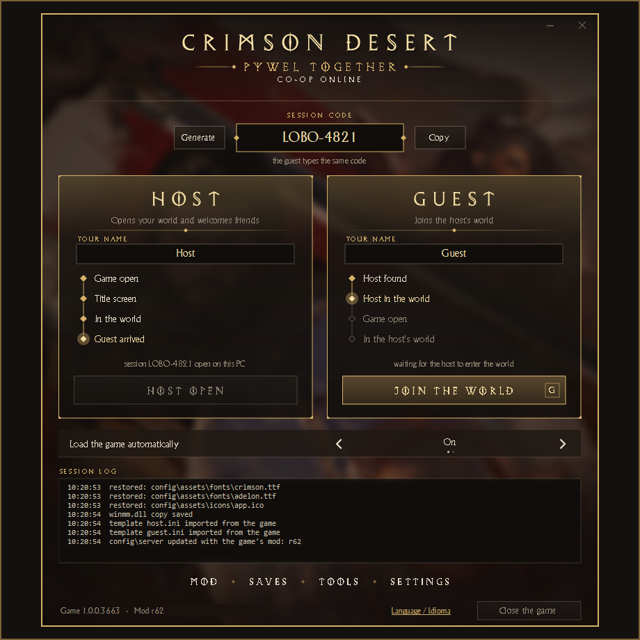
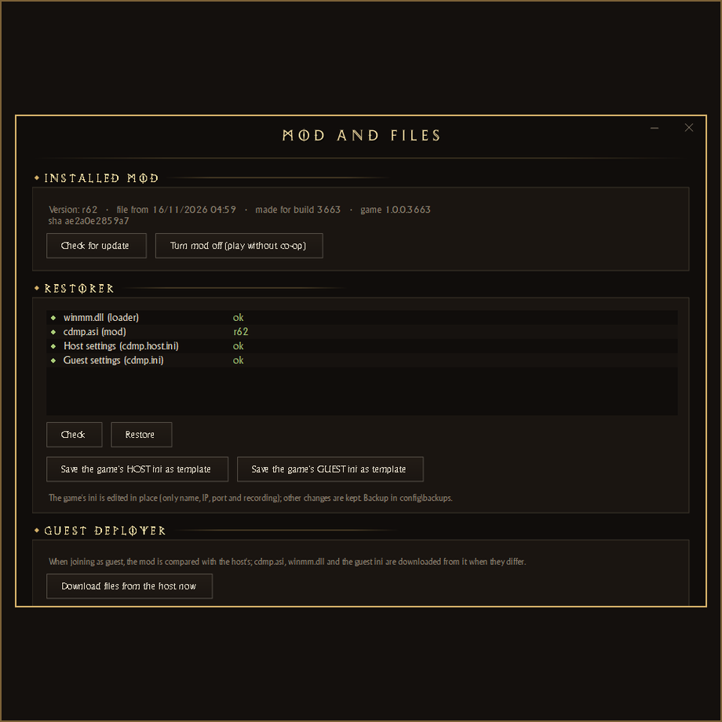
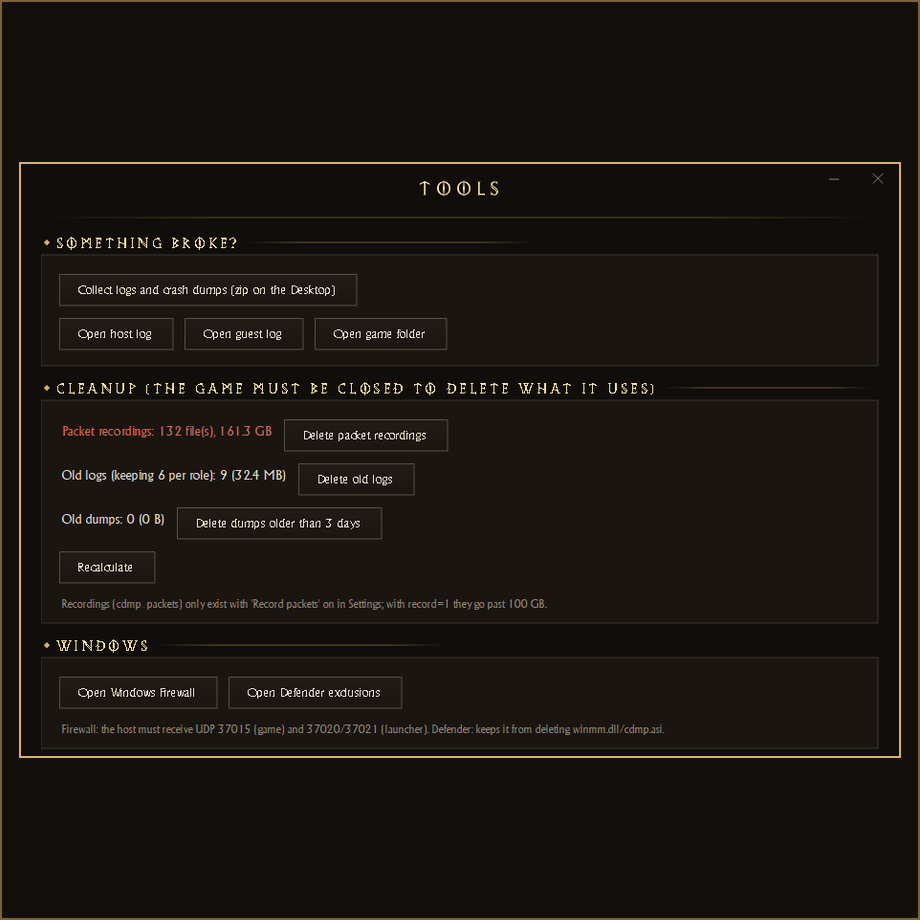
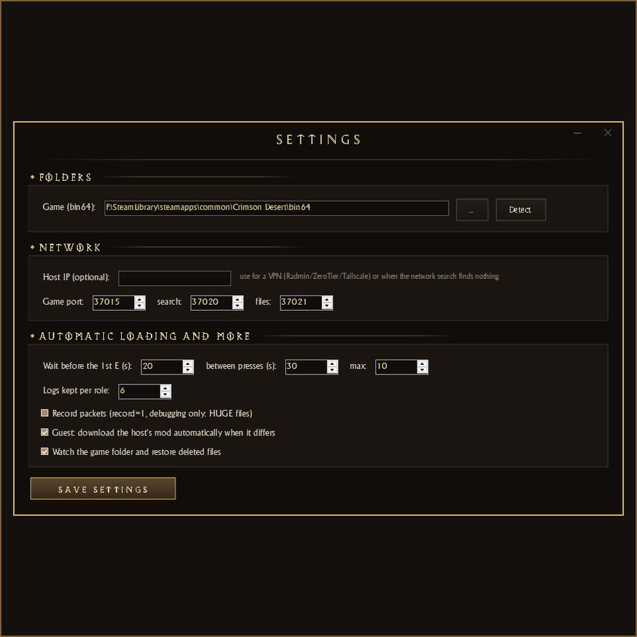
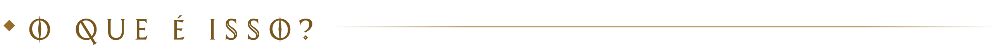
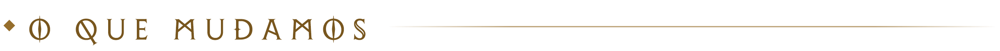
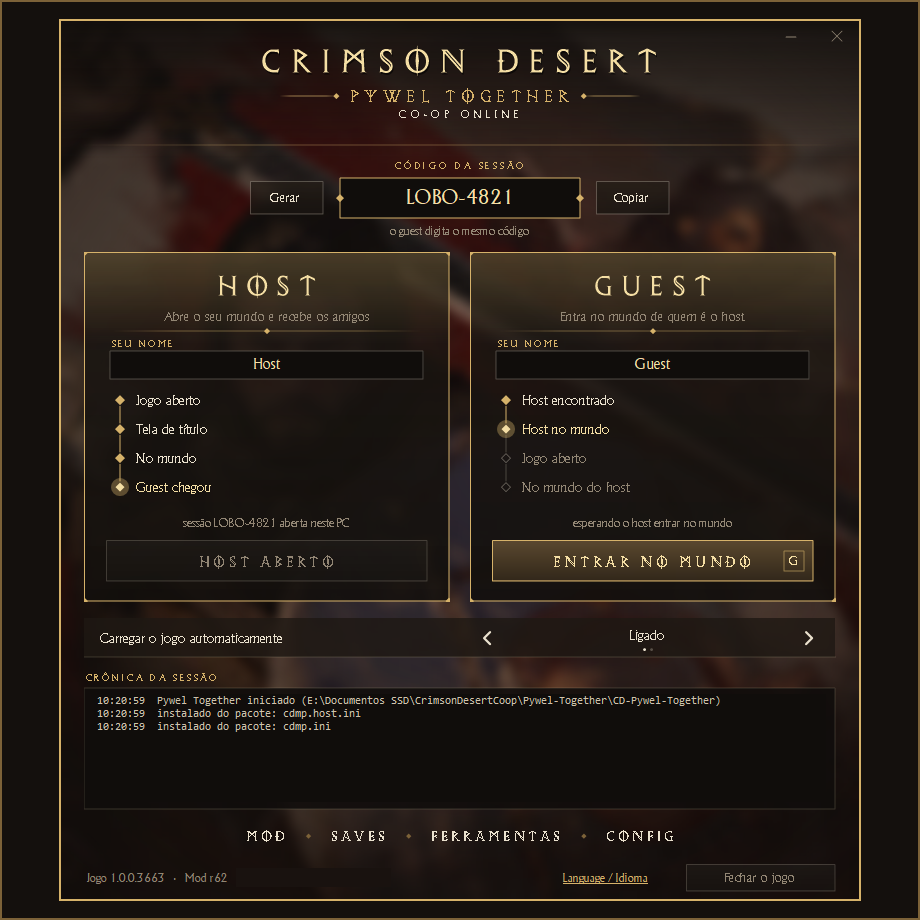
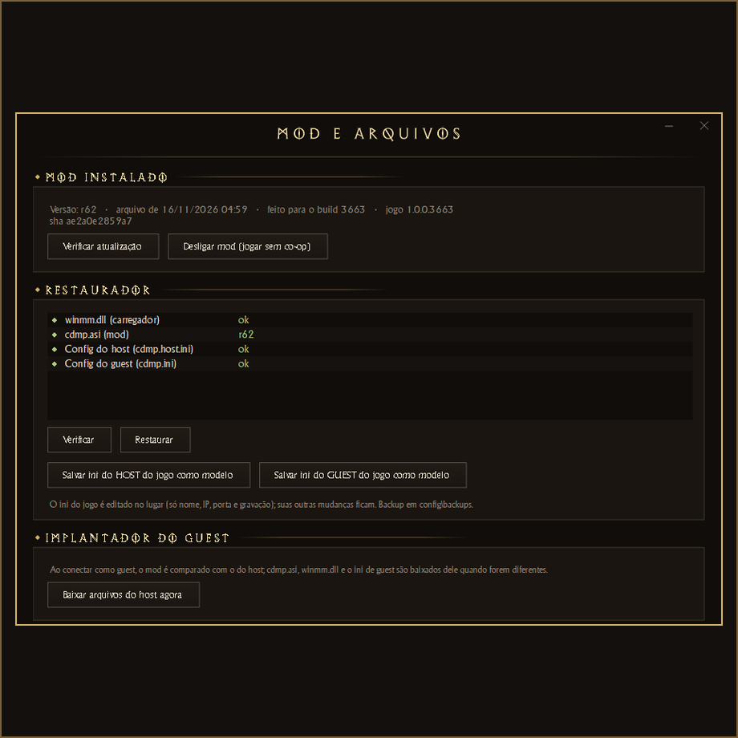
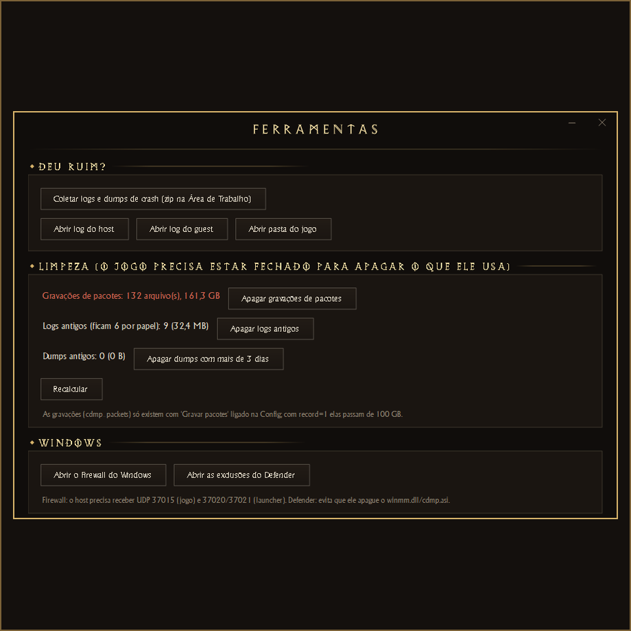
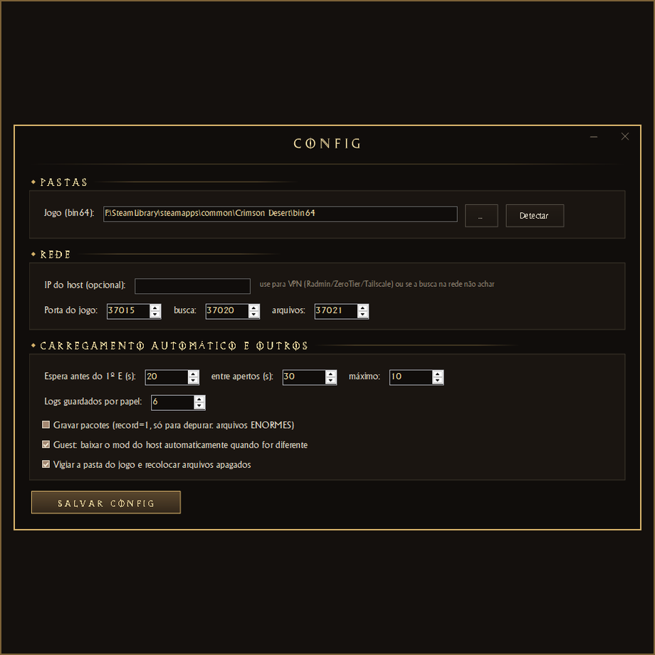

  <picture>
    <source media="(prefers-color-scheme: dark)" srcset="docs/images/title.png">
    
  </picture>

<h1 align="center">⚠️ DISCONTINUED ⚠️</h1>
<h3 align="center">This mod has been discontinued by its author. It is unfinished and does not work well.</h3>
<h3 align="center">Este mod foi descontinuado pelo autor. Está inacabado e não funciona bem.</h3>

> [!CAUTION]
> **Development stopped on November 23, 2026.** I am not going to continue this mod for now. There is no support, no updates and no guarantee that anything here works on your game.
>
> **If you want to continue it, go ahead.** Everything is here: the mod source, the launcher source, the research notes and the porting tools. Read [State when development stopped](#state) and [If you want to continue](#continue) first.
>
> **Back up your saves before trying anything.** One of the two modes of this mod makes the game save into a separate copy of the save folder instead of the real one.
>
> This project was made with **Claude** (Anthropic's AI). The porting, the mod changes and the launcher were written by Claude under my direction. Treat the code as AI written: check it before you trust it.

  
  
  
  
  

<b>English</b> &nbsp;·&nbsp; <a href="#portugues">Português</a>

 

<picture><source media="(prefers-color-scheme: dark)" srcset="docs/images/headings/h-what-dark.png"></picture>

Crimson Desert is a single player game. **Pywel Together** was an attempt to let two friends play it together online, with a Windows launcher and a mod, without editing any game file by hand.

It is a fan project made by two friends who wanted to play together, built on top of the co-op research of **ByJunter** (see Credits). It never reached a state we were happy with, and development stopped. The code is published so the work is not lost and so anyone can pick it up.

<picture><source media="(prefers-color-scheme: dark)" srcset="docs/images/headings/h-how-dark.png"></picture>

Two parts work together:

- **The mod** (`cdmp.asi`, loaded by Ultimate ASI Loader). It has two modes, chosen in its ini file:
  - **Own world** (`[coop]`): each player stays in their own game, with their own character and their own save. The other player is shown as a copy. Enemies and NPCs are not shared.
  - **Host's world** (`[session2]`): the guest joins the host's world through the game's own internal server, so both are in one world.
- **The launcher** (`launcher/`, Windows app "Pywel Together"): HOST and GUEST buttons that start the game in the right role. The two players find each other through Steam, either with a session code (anyone with the same code, friend or not) or by picking a Steam friend from a list. The guest's game is only opened once the host is inside the world. It also restores files removed by antivirus and cleans logs. It does not touch saves.

## State when development stopped

Everything below is about game build **1.0.0.3732**.

**What worked**

- Connection through Steam with nothing typed by hand. Picking a Steam friend was tested between two countries and connected. The session code path was written but never tested between two PCs.
- The launcher keeping the guest's game closed until the host is inside the world.
- In host's world mode, both players load into the same world.

**What did not work**

- **Host's world mode, guest's character.** The guest plays as a clone of the host's character. The part that loads the guest's own character (`src/mod/session2/guest_save_host.cpp`) still has call site addresses from build 2976 and turns itself off.
- **Host's world mode, enemies and NPCs.** For the guest, most enemies and NPCs stand in T pose and the guest cannot hit enemies.
- **Host's world mode, other modules.** Several modules refuse to install because they still check for build 2976 code. Search the host's log for `REFUSED` and `forced OFF` to list them.
- **Host's world mode, saves.** With `save_guard=redirect` the host's game saves into a copy (`%LOCALAPPDATA%\Pearl Abyss\CD\cdmp_save_sandbox`), not into the real save folder. The copy is rotated at the next start, so the progress of a session can be lost. We lost progress this way.
- **Own world mode.** The last launcher build switches the mod to this mode (`[coop] enabled=1`, `[session2] enabled=0`). This was the last change made and it was **never tested** on this build.
- **Enemy and NPC sync between two separate worlds** was never solved. It is the reason we moved from own world mode to host's world mode in the first place.
- In the older own world version, the body of the other player's mount was invisible.

</content>
</invoke>
<invoke name="mcp__https_mcp_desktopcommander_app_mcp__start_process">

## If you want to continue

**What is in this repository**

| Folder | What it is |
| --- | --- |
| `src/` | The mod (C++20). `src/mod/session2/` is host's world mode, `src/mod/net/coop.cpp` is own world mode, `src/mod/net/steam_transport.cpp` is the Steam connection, `src/mod/game/offsets.h` has the game addresses. |
| `launcher/` | The launcher (C#, .NET Framework 4.8, WinForms). `SteamRendezvous.cs` is the meeting point that tells the guest when the host is in the world, `SteamFriends.cs` lists Steam friends, `Deployer.cs` writes the mod ini. |
| `tools/porting/` | Python scripts used to carry addresses from one game build to the next by matching code bytes, the address maps they produced (`ns_map_*.json`) and the addresses they could not resolve (`ns_unres3.json`). |
| `tools/probe/`, `tools/scripts/` | Read only probe and helper scripts from the original project (RTTI dump, AOB scan, capture analysis). |
| `legacy-copy-mode-v5/` | Source of the older own world mod (ByJunter's first project, ported by us to an earlier game build). It has our enemy sync experiments in `src/mod/net/enemy_relay.cpp` and `src/mod/net/coop.cpp`. It does not run on build 3732. |
| `src-3663/`, `src-prev-174359/` | Earlier snapshots of the mod source, kept for comparison. |
| `docs/` | Research notes from the original author (in Spanish). Start with `OPCION-D-EMULADOR.md`, `ROADMAP.md` and `PLAN-PENDIENTES.md`. |

**Building**

- Mod: CMake + Visual Studio 2022, target `cdmp_mod`, configuration `RelWithDebInfo`. The output is `cdmp.asi`.
- Launcher: `launcher/build.ps1`, or `dotnet build PywelTogether.csproj -c Release`.

**The game build lock**

The mod reads and hooks the game at fixed addresses, so it only works on one game build. `src/mod/game/offsets.h` holds the PE timestamp it expects, and almost every module checks the bytes it is about to hook and refuses to install when they do not match. This is on purpose: a wrong hook crashes the game or damages a save. When Steam updates the game, every address has to be found again. Offsets inside structures usually survive an update; function and global addresses do not. Vtables can be found through RTTI, functions through their first bytes plus context.

**Where to start**

1. Decide the mode. Own world mode is the simple and safe one: nothing about saves is hooked and each player keeps their own character. What it lacks is shared enemies and NPCs.
2. If you go with own world mode: test `[coop]` on the current build first, since we never did. Then look at the enemy relay experiments in `legacy-copy-mode-v5/` for the enemy and NPC sync.
3. If you go with host's world mode: port the call sites in `guest_save_host.cpp` (the callers of LoadSlot, SavePlayerToSlot and FlushPendingSaveData, and the absent slot error site) so the guest gets their own character, then every module that logs `REFUSED`. Decide what to do about saves before letting anyone play on it.
4. Read the logs. The mod writes `cdmp.log` (guest) and `cdmp.host.log` (host) next to the game exe, and they say exactly what was installed and what was refused.

**Things that cost us time**

- The Steam App ID of a `CGameID` is in its low 24 bits. A wrong mask made the mod never find a friend who was playing.
- A player who appears offline or invisible on Steam cannot be found through friend presence. Pairing through a lobby (the session code) or through an explicit SteamID does not depend on presence.
- The mod talks to Steam through the game's own `steam_api64.dll` flat exports. Lobby call results are polled with `ISteamUtils` (`IsAPICallCompleted`, `GetAPICallResult`).
- The launcher's meeting point runs in a small child process that starts Steam as app 480, so the real game is never touched before it opens.
- Packet recording (`record=1`) writes tens of MB per minute. We ended up with more than 100 GB in the game folder. Keep it off.
- Two account folders inside the save folder made the guest's own character turn off. The mod now picks the folder of the Steam account that is logged in.

<picture><source media="(prefers-color-scheme: dark)" srcset="docs/images/headings/h-credits-dark.png"></picture>

This project is built on the work of **ByJunter**:

- [CrimsonDesertMultiplayer](https://github.com/ByJunter/CrimsonDesertMultiplayer)
- [CrimsonDesertMultiplayer-NativeServer](https://github.com/ByJunter/CrimsonDesertMultiplayer-NativeServer) (the original README is kept in `README-NativeServer-ByJunter.md`)

Our part was made with **Claude** (Anthropic's AI), directed by the author of this repository.

<picture><source media="(prefers-color-scheme: dark)" srcset="docs/images/headings/h-changed-dark.png"></picture>

- Ported the NativeServer mod from game build 1.0.0.2976 to **1.0.0.3663**, then to **1.0.0.3732** (addresses, signatures and packet layouts). The port is partial, see the state above.
- Steam pairing by session code (public lobby) and by Steam friend, with nothing to configure by hand.
- Smoother movement of the other player (adaptive interpolation, empty movement packets refilled on the host).
- Guest no longer stays frozen after reviving at a save point, and the loading after death is shorter.
- Horses: work on making the other player's horse move together with its rider in host's world mode. It still goes out of sync.
- New launcher app.

<picture><source media="(prefers-color-scheme: dark)" srcset="docs/images/headings/h-limits-dark.png"></picture>

- Works only with game build **1.0.0.3732**. Any Steam update breaks it.
- **One guest** only.
- It is not a working co-op. See [State when development stopped](#state).
- Back up your saves before using it.

<picture><source media="(prefers-color-scheme: dark)" srcset="docs/images/headings/h-license-dark.png"></picture>

GPL-3.0, same as the original projects (see `LICENSE`). You are free to continue, fork and publish your own version under the same license.

<picture><source media="(prefers-color-scheme: dark)" srcset="docs/images/headings/h-screens-dark.png"></picture>

The screenshots are from an earlier version of the launcher. The final one has no Saves tab and has the Steam friends list.

<b>Show app screenshots</b>

 
<table align="center">
  <tr>
    <td align="center" width="50%"> <b>Main screen</b></td>
    <td align="center" width="50%"> <b>Mod and files</b></td>
  </tr>
  <tr>
    <td align="center" width="50%"> <b>Tools</b></td>
    <td align="center" width="50%"> <b>Settings</b></td>
  </tr>
</table>

 

  <picture>
    <source media="(prefers-color-scheme: dark)" srcset="docs/images/headings/h-portugues-dark.png">
    
  </picture>

<a href="#top">English</a> &nbsp;·&nbsp; <b>Português</b>

<h1 align="center">⚠️ DESCONTINUADO ⚠️</h1>

> [!CAUTION]
> **O desenvolvimento parou em 23 de novembro de 2026.** Não vou continuar este mod por enquanto. Não tem suporte, não tem atualização e não tem garantia de que alguma coisa aqui funcione no seu jogo.
>
> **Se você quiser continuar, prossiga.** Está tudo aqui: o código do mod, o código do launcher, as notas de pesquisa e as ferramentas de porte. Leia antes [Como ficou quando o desenvolvimento parou](#situacao) e [Se você quiser continuar](#continuar).
>
> **Faça backup dos seus saves antes de testar qualquer coisa.** Um dos dois modos deste mod faz o jogo salvar numa cópia separada da pasta de save, e não na pasta real.
>
> Este projeto foi feito com o **Claude** (IA da Anthropic). O porte, as mudanças no mod e o launcher foram escritos pelo Claude sob a minha direção. Trate o código como escrito por IA: confira antes de confiar.

<picture><source media="(prefers-color-scheme: dark)" srcset="docs/images/headings/h-pt-what-dark.png"></picture>

Crimson Desert é um jogo single player. O **Pywel Together** foi uma tentativa de deixar dois amigos jogarem juntos online, com um launcher de Windows e um mod, sem mexer em nenhum arquivo do jogo na mão.

É um projeto de fã, feito por dois amigos que queriam jogar juntos, em cima da pesquisa de co-op do **ByJunter** (veja Créditos). Ele nunca chegou num estado que nos deixasse satisfeitos, e o desenvolvimento parou. O código está publicado para o trabalho não se perder e para qualquer pessoa poder continuar.

<picture><source media="(prefers-color-scheme: dark)" srcset="docs/images/headings/h-pt-how-dark.png"></picture>

São duas partes trabalhando juntas:

- **O mod** (`cdmp.asi`, carregado pelo Ultimate ASI Loader). Ele tem dois modos, escolhidos no arquivo ini:
  - **Cada um no seu mundo** (`[coop]`): cada jogador fica no próprio jogo, com o próprio personagem e o próprio save. O outro jogador aparece como uma cópia. Inimigos e NPCs não são compartilhados.
  - **Mundo do host** (`[session2]`): o guest entra no mundo do host pelo próprio servidor interno do jogo, então os dois ficam num mundo só.
- **O launcher** (`launcher/`, app de Windows "Pywel Together"): botões HOST e GUEST que abrem o jogo no papel certo. Os dois jogadores se acham pela Steam, com um código da sessão (qualquer pessoa com o mesmo código, amiga ou não) ou escolhendo um amigo da Steam numa lista. O jogo do guest só abre depois que o host está dentro do mundo. Ele também recoloca arquivos apagados pelo antivírus e limpa os logs. Ele não mexe em save.

## Como ficou quando o desenvolvimento parou

Tudo abaixo é sobre o build **1.0.0.3732** do jogo.

**O que funcionou**

- Conexão pela Steam sem digitar nada na mão. Escolher um amigo da Steam foi testado entre dois países e conectou. O caminho do código da sessão foi escrito, mas nunca foi testado entre dois PCs.
- O launcher segurando o jogo do guest fechado até o host estar dentro do mundo.
- No modo mundo do host, os dois jogadores carregam no mesmo mundo.

**O que não funcionou**

- **Modo mundo do host, personagem do guest.** O guest joga como uma cópia do personagem do host. A parte que carrega o personagem do próprio guest (`src/mod/session2/guest_save_host.cpp`) ainda está com os endereços de chamada do build 2976 e se desliga sozinha.
- **Modo mundo do host, inimigos e NPCs.** Para o guest, a maioria dos inimigos e NPCs fica em pose T e o guest não consegue bater nos inimigos.
- **Modo mundo do host, outros módulos.** Vários módulos se recusam a instalar porque ainda conferem o código do build 2976. Procure `REFUSED` e `forced OFF` no log do host para listar todos.
- **Modo mundo do host, saves.** Com `save_guard=redirect` o jogo do host salva numa cópia (`%LOCALAPPDATA%\Pearl Abyss\CD\cdmp_save_sandbox`), não na pasta de save real. A cópia é trocada na próxima abertura, então o progresso de uma sessão pode se perder. Nós perdemos progresso assim.
- **Modo cada um no seu mundo.** A última versão do launcher coloca o mod nesse modo (`[coop] enabled=1`, `[session2] enabled=0`). Foi a última mudança feita e ela **nunca foi testada** neste build.
- **Sincronizar inimigos e NPCs entre dois mundos separados** nunca foi resolvido. Foi por isso que saímos do modo cada um no seu mundo para o modo mundo do host.
- Na versão antiga de cada um no seu mundo, o corpo da montaria do outro jogador ficava invisível.

## Se você quiser continuar

**O que tem neste repositório**

| Pasta | O que é |
| --- | --- |
| `src/` | O mod (C++20). `src/mod/session2/` é o modo mundo do host, `src/mod/net/coop.cpp` é o modo cada um no seu mundo, `src/mod/net/steam_transport.cpp` é a conexão pela Steam, `src/mod/game/offsets.h` tem os endereços do jogo. |
| `launcher/` | O launcher (C#, .NET Framework 4.8, WinForms). `SteamRendezvous.cs` é o ponto de encontro que avisa o guest quando o host está no mundo, `SteamFriends.cs` lista os amigos da Steam, `Deployer.cs` grava o ini do mod. |
| `tools/porting/` | Scripts em Python usados para levar endereços de um build do jogo para o seguinte comparando os bytes do código, os mapas de endereços que eles geraram (`ns_map_*.json`) e os endereços que eles não conseguiram resolver (`ns_unres3.json`). |
| `tools/probe/`, `tools/scripts/` | Probe só de leitura e scripts de apoio do projeto original (dump de RTTI, busca de AOB, análise de capturas). |
| `legacy-copy-mode-v5/` | Código do mod antigo de cada um no seu mundo (primeiro projeto do ByJunter, portado por nós para um build anterior do jogo). Tem as nossas experiências de sincronização de inimigos em `src/mod/net/enemy_relay.cpp` e `src/mod/net/coop.cpp`. Não roda no build 3732. |
| `src-3663/`, `src-prev-174359/` | Versões anteriores do código do mod, guardadas para comparação. |
| `docs/` | Notas de pesquisa do autor original (em espanhol). Comece por `OPCION-D-EMULADOR.md`, `ROADMAP.md` e `PLAN-PENDIENTES.md`. |

**Compilando**

- Mod: CMake + Visual Studio 2022, alvo `cdmp_mod`, configuração `RelWithDebInfo`. O resultado é o `cdmp.asi`.
- Launcher: `launcher/build.ps1`, ou `dotnet build PywelTogether.csproj -c Release`.

**A trava do build do jogo**

O mod lê e intercepta o jogo em endereços fixos, então só funciona num build do jogo. O `src/mod/game/offsets.h` guarda o timestamp do PE que ele espera, e quase todo módulo confere os bytes que vai interceptar e se recusa a instalar quando não batem. Isso é de propósito: um hook errado derruba o jogo ou estraga um save. Quando a Steam atualiza o jogo, todo endereço precisa ser achado de novo. Os offsets dentro das estruturas costumam sobreviver a uma atualização; endereços de função e de globais não. As vtables dá para achar pela RTTI, as funções pelos primeiros bytes mais o contexto.

**Por onde começar**

1. Decida o modo. Cada um no seu mundo é o simples e seguro: nada de save é interceptado e cada jogador fica com o próprio personagem. O que falta nele são inimigos e NPCs compartilhados.
2. Se for pelo modo cada um no seu mundo: teste primeiro o `[coop]` no build atual, porque nós nunca testamos. Depois veja as experiências de relay de inimigos em `legacy-copy-mode-v5/` para a sincronização de inimigos e NPCs.
3. Se for pelo modo mundo do host: porte os pontos de chamada do `guest_save_host.cpp` (quem chama LoadSlot, SavePlayerToSlot e FlushPendingSaveData, e o ponto do erro de slot ausente) para o guest ter o próprio personagem, e depois cada módulo que escreve `REFUSED` no log. Decida o que fazer com os saves antes de deixar alguém jogar nele.
4. Leia os logs. O mod escreve `cdmp.log` (guest) e `cdmp.host.log` (host) ao lado do exe do jogo, e eles dizem exatamente o que foi instalado e o que foi recusado.

**Coisas que nos custaram tempo**

- O App ID da Steam dentro de um `CGameID` fica nos 24 bits baixos. Uma máscara errada fazia o mod nunca achar o amigo que estava jogando.
- Um jogador que aparece offline ou invisível na Steam não é achado pela presença de amigos. Parear por lobby (o código da sessão) ou por SteamID explícito não depende de presença.
- O mod fala com a Steam pelos exports flat da `steam_api64.dll` do próprio jogo. Os resultados das chamadas de lobby são lidos com `ISteamUtils` (`IsAPICallCompleted`, `GetAPICallResult`).
- O ponto de encontro do launcher roda num processo filho pequeno que inicia a Steam como app 480, então o jogo de verdade não é tocado antes de abrir.
- A gravação de pacotes (`record=1`) escreve dezenas de MB por minuto. Acabamos com mais de 100 GB na pasta do jogo. Deixe desligada.
- Duas pastas de conta dentro da pasta de save faziam o personagem próprio do guest se desligar. O mod agora escolhe a pasta da conta Steam que está logada.

<picture><source media="(prefers-color-scheme: dark)" srcset="docs/images/headings/h-pt-credits-dark.png"></picture>

Este projeto foi feito em cima do trabalho do **ByJunter**:

- [CrimsonDesertMultiplayer](https://github.com/ByJunter/CrimsonDesertMultiplayer)
- [CrimsonDesertMultiplayer-NativeServer](https://github.com/ByJunter/CrimsonDesertMultiplayer-NativeServer) (o README original está em `README-NativeServer-ByJunter.md`)

A nossa parte foi feita com o **Claude** (IA da Anthropic), dirigido pelo autor deste repositório.

<picture><source media="(prefers-color-scheme: dark)" srcset="docs/images/headings/h-pt-changed-dark.png"></picture>

- Port do mod NativeServer do build 1.0.0.2976 para o **1.0.0.3663** e depois para o **1.0.0.3732** (endereços, assinaturas e formato dos pacotes). O port é parcial, veja a situação acima.
- Pareamento pela Steam por código da sessão (lobby público) e por amigo da Steam, sem nada para configurar na mão.
- Movimento do outro jogador mais liso (interpolação adaptativa e pacotes de movimento vazios preenchidos no host).
- O guest não fica mais travado depois de reviver no ponto de salvamento, e o carregamento depois da morte ficou mais curto.
- Cavalos: trabalho para o cavalo do outro jogador andar junto com o cavaleiro no modo mundo do host. Ainda dessincroniza.
- App launcher novo.

<picture><source media="(prefers-color-scheme: dark)" srcset="docs/images/headings/h-pt-limits-dark.png"></picture>

- Só funciona no build **1.0.0.3732** do jogo. Qualquer atualização da Steam quebra.
- **Um guest** só.
- Não é um co-op funcionando. Veja [Como ficou quando o desenvolvimento parou](#situacao).
- Faça backup dos seus saves antes de usar.

<picture><source media="(prefers-color-scheme: dark)" srcset="docs/images/headings/h-pt-license-dark.png"></picture>

GPL 3.0, a mesma dos projetos originais (veja `LICENSE`). Você pode continuar, fazer fork e publicar a sua versão sob a mesma licença.

<picture><source media="(prefers-color-scheme: dark)" srcset="docs/images/headings/h-pt-screens-dark.png"></picture>

As imagens são de uma versão anterior do launcher. A final não tem a aba Saves e tem a lista de amigos da Steam.

<b>Ver imagens do app</b>

 
<table align="center">
  <tr>
    <td align="center" width="50%"> <b>Tela principal</b></td>
    <td align="center" width="50%"> <b>Mod e arquivos</b></td>
  </tr>
  <tr>
    <td align="center" width="50%"> <b>Ferramentas</b></td>
    <td align="center" width="50%"> <b>Config</b></td>
  </tr>
</table>

