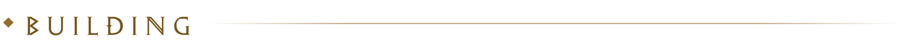
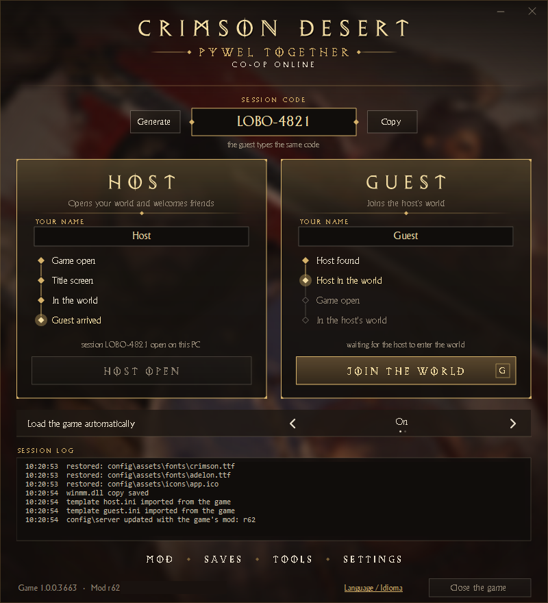
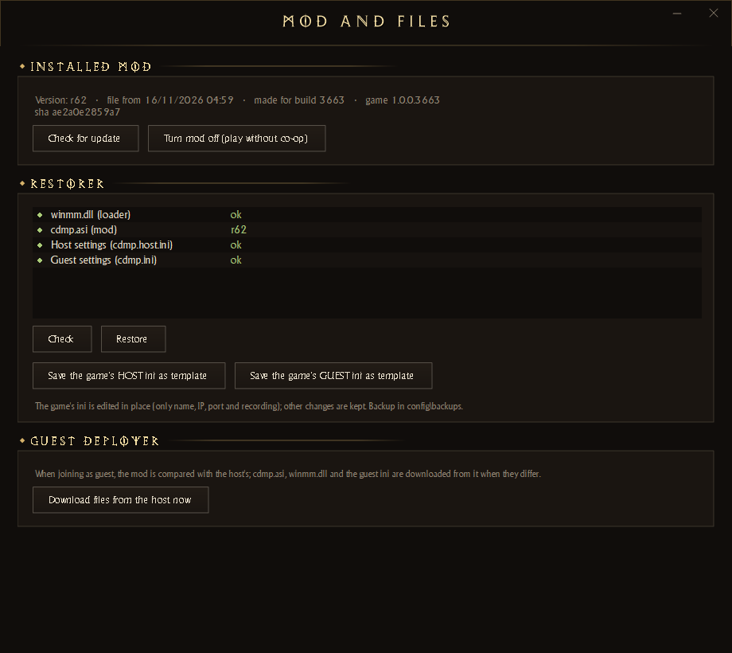
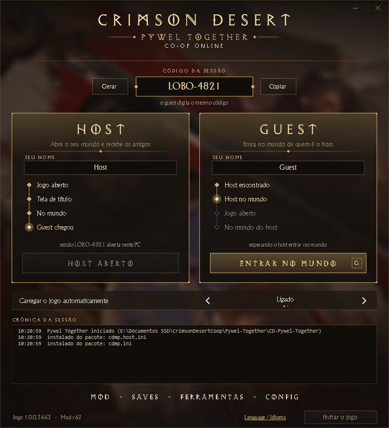

  <picture>
    <source media="(prefers-color-scheme: dark)" srcset="docs/images/title.png">
    
  </picture>

  
  
  
  

<b>English</b> &nbsp;·&nbsp; <a href="#portugues">Português</a>

 

<picture><source media="(prefers-color-scheme: dark)" srcset="docs/images/headings/h-what-dark.png"></picture>

Crimson Desert is a single player game. **Pywel Together** lets two friends play it together online: one player opens their game as the **host**, and the other (the **guest**) enters the host's world with their own character. Both walk around the same map and see each other move, with the same people and enemies around them.

You don't need to edit any game file by hand. Open the **Pywel Together** app, choose **Host** or **Guest**, type the same session code on both PCs and the app opens the game, loads the save and puts the guest inside the host's world. Each player keeps their own character and their own story progress.

It's a fan project made by two friends who wanted to play together, built on top of the co-op research of **ByJunter** (see Credits). It is still being tested, so expect bugs.

<picture><source media="(prefers-color-scheme: dark)" srcset="docs/images/headings/h-how-dark.png"></picture>

Two parts work together:

- **The mod** (`cdmp.asi`, loaded by Ultimate ASI Loader): the guest joins the host's world through the game's own internal server. Same world, same NPCs and enemies.
- **The launcher** (`launcher/`, Windows app "Pywel Together"): HOST and GUEST buttons that start the game in the right role, find the host by a session code, copy the mod files from the host when they differ, restore files removed by antivirus, manage saves and clean logs.

> **Status: provisional and still in testing.** This was made for our own sessions while the game has no official co-op. It is **not** a maintained project. Anyone who wants to continue or improve it is welcome to (see License).

<picture><source media="(prefers-color-scheme: dark)" srcset="docs/images/headings/h-credits-dark.png"></picture>

This project is built on the work of **ByJunter**:

- [CrimsonDesertMultiplayer](https://github.com/ByJunter/CrimsonDesertMultiplayer)
- [CrimsonDesertMultiplayer-NativeServer](https://github.com/ByJunter/CrimsonDesertMultiplayer-NativeServer) (the original README is kept in `README-NativeServer-ByJunter.md`)

<picture><source media="(prefers-color-scheme: dark)" srcset="docs/images/headings/h-changed-dark.png"></picture>

- Ported the NativeServer mod from game build 1.0.0.2976 to **1.0.0.3663** (addresses, signatures and packet layouts).
- Smoother movement of the other player (adaptive interpolation, empty movement packets refilled on the host).
- Guest no longer stays frozen after reviving at a save point, and the loading after death is shorter.
- New launcher app.

<picture><source media="(prefers-color-scheme: dark)" srcset="docs/images/headings/h-limits-dark.png"></picture>

- Works only with game build **1.0.0.3663**. A Steam update can break it.
- **One guest** for now.
- Same local network works. Over the internet only through a VPN that gives both PCs a shared network (Radmin, ZeroTier, Tailscale): **not tested yet**.
- Not tested yet: horse/mounts for the guest, enemies in both directions, combat.
- Back up your saves before using it.

<picture><source media="(prefers-color-scheme: dark)" srcset="docs/images/headings/h-building-dark.png"></picture>

- Mod: CMake + Visual Studio 2022, target `cdmp_mod` (see `CMakeLists.txt`).
- Launcher: .NET Framework 4.8, `launcher/build.ps1`.

<picture><source media="(prefers-color-scheme: dark)" srcset="docs/images/headings/h-license-dark.png"></picture>

GPL-3.0, same as the original projects (see `LICENSE`).

<picture><source media="(prefers-color-scheme: dark)" srcset="docs/images/headings/h-screens-dark.png"></picture>

  
  &nbsp;
  

 

  <picture>
    <source media="(prefers-color-scheme: dark)" srcset="docs/images/headings/h-portugues-dark.png">
    
  </picture>

<a href="#top">English</a> &nbsp;·&nbsp; <b>Português</b>

<picture><source media="(prefers-color-scheme: dark)" srcset="docs/images/headings/h-pt-what-dark.png"></picture>

Crimson Desert é um jogo single player. O **Pywel Together** deixa dois amigos jogarem juntos online: um jogador abre o jogo como **host**, e o outro (o **guest**) entra no mundo do host com o próprio personagem. Os dois andam pelo mesmo mapa e veem um ao outro se movendo, com as mesmas pessoas e os mesmos inimigos por perto.

Não precisa mexer em nenhum arquivo do jogo na mão. Abra o app **Pywel Together**, escolha **Host** ou **Guest**, digite o mesmo código da sessão nos dois PCs e o app abre o jogo, carrega o save e coloca o guest dentro do mundo do host. Cada jogador mantém o seu personagem e o seu progresso na história.

É um projeto de fã, feito por dois amigos que queriam jogar juntos, em cima da pesquisa de co-op do **ByJunter** (veja Créditos). Ainda está em teste, então espere bugs.

<picture><source media="(prefers-color-scheme: dark)" srcset="docs/images/headings/h-pt-how-dark.png"></picture>

São duas partes trabalhando juntas:

- **O mod** (`cdmp.asi`, carregado pelo Ultimate ASI Loader): o guest entra no mundo do host pelo próprio servidor interno do jogo. Mesmo mundo, mesmos NPCs e inimigos.
- **O launcher** (`launcher/`, app de Windows "Pywel Together"): botões HOST e GUEST que abrem o jogo no papel certo, acham o host pelo código da sessão, copiam os arquivos do mod do host quando forem diferentes, recolocam arquivos apagados pelo antivírus, cuidam dos saves e limpam os logs.

> **Situação: provisório e ainda em teste.** Foi feito para as nossas próprias partidas enquanto o jogo não tem co-op oficial. **Não** é um projeto mantido. Quem quiser continuar ou melhorar, fique à vontade (veja Licença).

<picture><source media="(prefers-color-scheme: dark)" srcset="docs/images/headings/h-pt-credits-dark.png"></picture>

Este projeto foi feito em cima do trabalho do **ByJunter**:

- [CrimsonDesertMultiplayer](https://github.com/ByJunter/CrimsonDesertMultiplayer)
- [CrimsonDesertMultiplayer-NativeServer](https://github.com/ByJunter/CrimsonDesertMultiplayer-NativeServer) (o README original está em `README-NativeServer-ByJunter.md`)

<picture><source media="(prefers-color-scheme: dark)" srcset="docs/images/headings/h-pt-changed-dark.png"></picture>

- Port do mod NativeServer do build 1.0.0.2976 para o **1.0.0.3663** (endereços, assinaturas e formato dos pacotes).
- Movimento do outro jogador mais liso (interpolação adaptativa e pacotes de movimento vazios preenchidos no host).
- O guest não fica mais travado depois de reviver no ponto de salvamento, e o carregamento depois da morte ficou mais curto.
- App launcher novo.

<picture><source media="(prefers-color-scheme: dark)" srcset="docs/images/headings/h-pt-limits-dark.png"></picture>

- Só funciona no build **1.0.0.3663** do jogo. Uma atualização da Steam pode quebrar.
- **Um guest** por enquanto.
- Na mesma rede local funciona. Pela internet, só com uma VPN que coloque os dois PCs na mesma rede (Radmin, ZeroTier, Tailscale): **ainda não testado**.
- Ainda sem teste: cavalo e montarias do guest, inimigos nos dois sentidos, combate.
- Faça backup dos seus saves antes de usar.

<picture><source media="(prefers-color-scheme: dark)" srcset="docs/images/headings/h-pt-building-dark.png"></picture>

- Mod: CMake + Visual Studio 2022, alvo `cdmp_mod` (veja `CMakeLists.txt`).
- Launcher: .NET Framework 4.8, `launcher/build.ps1`.

<picture><source media="(prefers-color-scheme: dark)" srcset="docs/images/headings/h-pt-license-dark.png"></picture>

GPL 3.0, a mesma dos projetos originais (veja `LICENSE`).

<picture><source media="(prefers-color-scheme: dark)" srcset="docs/images/headings/h-pt-screens-dark.png"></picture>

  

